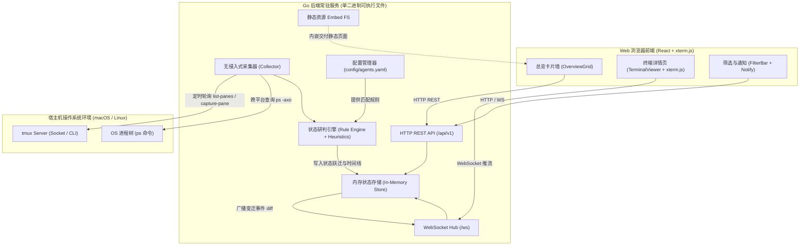
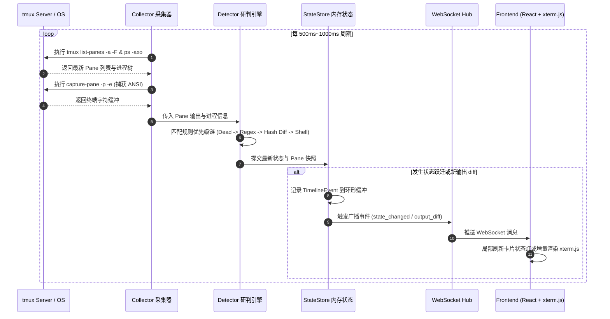

# 技术方案设计（Design）

> 文件路径：`docs/spec/versions/v1/design.md`
> 适用版本：v1 · 生成日期：2026-11-11
> 前置依据：`docs/spec/versions/v1/requirements.md`

---

## 1. 项目结构

```
tmux-ui/
├── cmd/
│   └── tmux-ui/
│       └── main.go                 # 服务端主入口（单二进制启动器）
├── config/
│   └── agents.yaml                 # 智能体识别规则与系统配置
├── internal/
│   ├── collector/                  # tmux CLI 调用、解析与 ps 进程树探测
│   │   ├── tmux_cli.go
│   │   ├── process_tree.go
│   │   └── collector.go
│   ├── detector/                   # 规则引擎与多智能体状态判定
│   │   ├── engine.go
│   │   └── heuristics.go
│   ├── store/                      # 内存状态存储、Ring Buffer 与 Diff 计算
│   │   ├── memory_store.go
│   │   └── timeline.go
│   ├── server/                     # HTTP REST 路由、WebSocket 推流、静态资源 embed
│   │   ├── http_server.go
│   │   ├── ws_hub.go
│   │   └── embed.go
│   └── model/                      # 核心领域实体与常量定义
│       ├── state.go
│       └── pane.go
├── web/                            # React 前端工程 (Vite + Tailwind + xterm.js)
│   ├── src/
│   │   ├── assets/
│   │   ├── components/
│   │   │   ├── OverviewGrid.tsx    # 响应式卡片墙
│   │   │   ├── PaneCard.tsx        # 单个 Pane 卡片与状态灯
│   │   │   ├── FilterBar.tsx       # 状态筛选栏
│   │   │   ├── TerminalViewer.tsx  # xterm.js 终端渲染器
│   │   │   └── TimelineDrawer.tsx  # 状态变迁历史抽屉
│   │   ├── hooks/
│   │   │   ├── useTmuxWS.ts        # WebSocket 连接与事件监听
│   │   │   └── useNotifications.ts # 浏览器通知权限与触发
│   │   ├── types/
│   │   │   └── index.ts
│   │   ├── App.tsx
│   │   └── main.tsx
│   ├── index.html
│   ├── package.json
│   ├── tailwind.config.js
│   └── vite.config.ts
├── docs/                           # SDD 规范文档库
│   ├── AGENTS.md
│   └── spec/
└── .gitattributes
```

---

## 2. 架构概览

### 2.1 系统组件关系图



### 2.2 核心数据流图



---

## 3. 技术选型

| 维度 | 选型 | 备选方案 | 选型理由 |
|------|------|----------|----------|
| **后端主语言** | **Go 1.22+** | Node.js | 单一可执行文件，通过 `embed` 零依赖分发，资源消耗极低，天生高并发。 |
| **Web 路由框架** | **Go `net/http` + `chi/v5`** | Gin, Fiber | Chi 轻量、零外部繁重依赖，100% 兼容标准库 `http.Handler`，非常便于测试。 |
| **实时通信** | **`gorilla/websocket`** | SSE (Server-Sent Events) | 全双工双向通信，生态成熟，支持长连接状态保持与低延迟广播。 |
| **前端主框架** | **React 18/19 + Vite** | Vue 3 | React 生态与 xterm.js 集成极佳，Vite 构建速度快且输出轻量。 |
| **样式方案** | **Tailwind CSS** | CSS Modules | 原子化类名，快速构建响应式卡片墙与深色终端主题，打包体积小。 |
| **终端渲染引擎** | **`@xterm/xterm`** | ANSI 文本直接 HTML 转义 | 原生支持 ANSI 色彩、控制序列、自适应尺寸（FitAddon），性能极高。 |
| **配置管理** | **YAML (`gopkg.in/yaml.v3`)** | JSON, TOML | 人类可读性强，便于用户直接编辑正则表达式规则。 |

---

## 4. 测试工具选型

> ⚠️ 本节仅列出选用的测试框架，测试金字塔、覆盖率目标与详细策略详见 STEP 5 `test_strategy.md`。

| 测试类型 | 所选工具 / 框架 |
|---------|----------------|
| **后端单元测试** | Go 标准库 `testing` + `testify`（`assert`, `require`） |
| **后端 HTTP / WS 集成测试** | Go `net/http/httptest` + `gorilla/websocket` |
| **前端单元与组件测试** | **Vitest** + **React Testing Library** + **jsdom** |
| **前端 E2E 与视觉回归** | **Playwright MCP**（截屏留存 Baseline 与 Diff） |
| **性能基准测试** | Go 标准 `testing.B`（`go test -bench`） |

---

## 5. 安全性说明

1. **本地网络隔离**：
   - 服务端默认仅监听 `127.0.0.1:8080`，严禁未经保护直接公开监听 `0.0.0.0`。
2. **可选 Token 认证保护**：
   - 支持在启动时通过 `--token` 参数或随机生成安全 Token。开启后，所有 HTTP 接口和 WebSocket 必须携带有效 Bearer Token。
3. **严格只读原则**：
   - MVP 阶段系统严格坚持只读，仅调用 `list-panes`、`capture-pane` 和 `ps`。代码层杜绝任何 `tmux send-keys` 写入逻辑，彻底杜绝远程命令执行（RCE）风险。
4. **外部命令转义防注入**：
   - 所有外部命令执行统一使用参数化方式（`exec.Command(name, arg1, arg2...)`），严禁使用拼接字符串直接传给 shell 执行。

---

## 6. 数据与配置设计

完整的配置 Schema、运行时状态机定义、并发安全保证与 Ring Buffer 规格，详见：
👉 **[docs/spec/versions/v1/data.md](file:///e:/Nextcloud/coding/agents/tmux-ui/docs/spec/versions/v1/data.md)**

---

## 7. 接口设计

完整的 HTTP REST 接口定义、WebSocket 消息帧协议与统一错误码字典，详见：
👉 **[docs/spec/versions/v1/api.md](file:///e:/Nextcloud/coding/agents/tmux-ui/docs/spec/versions/v1/api.md)**

