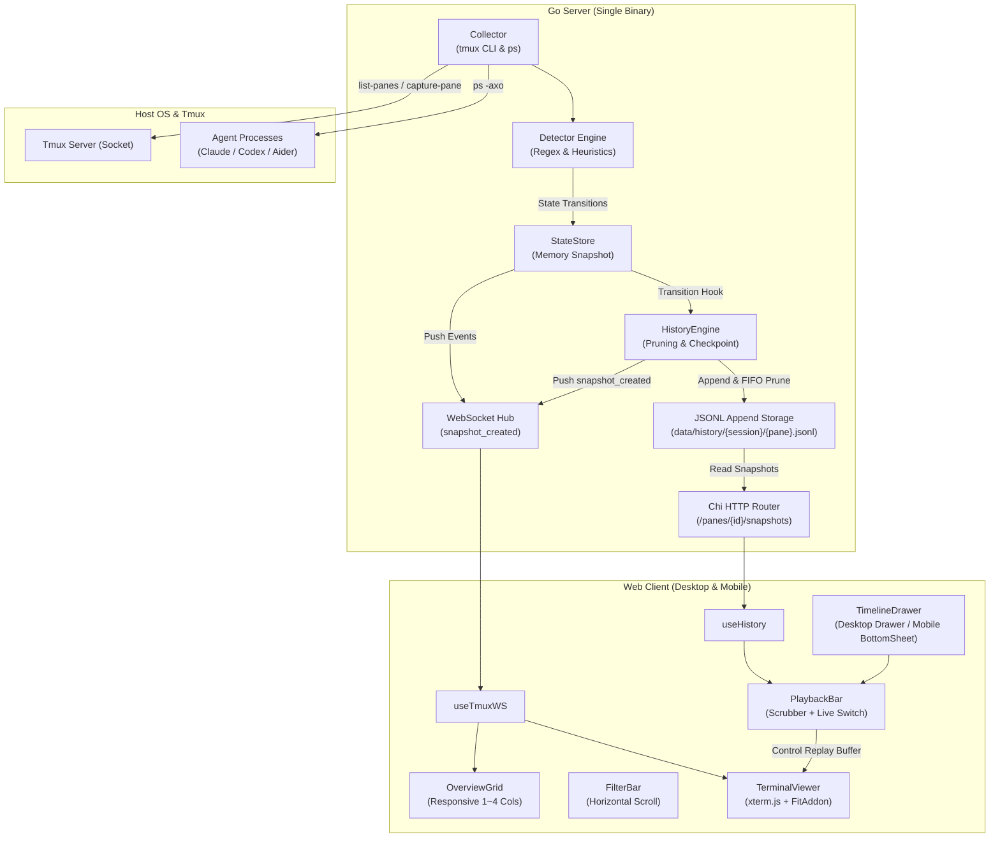
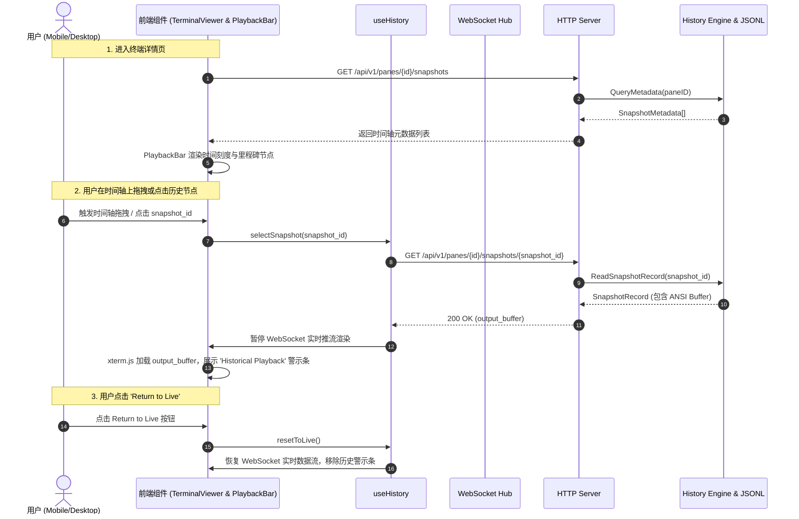

# 技术方案设计（Design）

> 文件路径：`docs/spec/versions/v2/design.md`
> 适用版本：v2 · 生成日期：2026-11-12
> 前置依据：`docs/spec/versions/v2/requirements.md`

---

## 1. 项目结构

```
tmux-ui/
├── cmd/
│   └── tmux-ui/
│       └── main.go                 # 服务端主入口（单二进制启动器，集成 History 初始化）
├── config/
│   └── agents.yaml                 # 规则配置（包含 v2 history 配置段）
├── internal/
│   ├── collector/                  # tmux CLI 调用与 ps 进程探测（沿用 v1）
│   ├── detector/                   # 规则引擎状态推断（沿用 v1）
│   ├── history/                    # [v2 新增] 历史快照持久化引擎
│   │   ├── engine.go               # 快照生命周期管理、Checkpoint 定时器与淘汰策略
│   │   ├── storage.go              # 本地 JSONL 追加读写与文件原子替换
│   │   └── engine_test.go          # 单元测试与并发写入测试
│   ├── store/                      # 内存状态存储（扩展接入 History 变迁钩子）
│   ├── server/                     # HTTP REST 路由与 WebSocket Hub
│   │   ├── http_server.go          # 扩展 /api/v1/panes/{id}/snapshots 路由
│   │   └── ws_hub.go               # 支持 snapshot_created 广播
│   └── model/                      # 领域实体（扩展 SnapshotRecord / Metadata）
├── web/                            # 前端工程
│   ├── src/
│   │   ├── components/
│   │   │   ├── OverviewGrid.tsx    # [v2 改造] 响应式单列/多列卡片网格
│   │   │   ├── FilterBar.tsx       # [v2 改造] 移动端横向滑动标签与全宽搜索
│   │   │   ├── TerminalViewer.tsx  # [v2 改造] xterm 自适应缩放与浮动快捷操作
│   │   │   ├── PlaybackBar.tsx     # [v2 新增] 时间轴历史回放播放器组件
│   │   │   ├── BottomSheet.tsx     # [v2 新增] 移动端专属自底向上滑出抽屉
│   │   │   └── TimelineDrawer.tsx  # [v2 改造] 适配桌面端右侧与移动端 Bottom Sheet
│   │   ├── hooks/
│   │   │   ├── useTmuxWS.ts        # 扩展快照广播监听
│   │   │   ├── useHistory.ts       # [v2 新增] 历史快照拉取与回放状态管理
│   │   │   └── useMediaQuery.ts    # [v2 新增] 设备断点侦测 (<768px 移动端判断)
│   │   ├── types/
│   │   └── App.tsx
│   └── tailwind.config.js          # Tailwind 响应式断点与自定义样式
├── data/
│   └── history/                    # 本地历史快照持久化目录（.gitignore 保障敏感隔离）
└── docs/
    └── spec/
        └── versions/
            ├── v1-finished/
            └── v2/
                ├── requirements.md
                ├── design.md
                ├── data.md
                └── api.md
```

---

## 2. 架构概览

### 2.1 系统架构图



---

### 2.2 核心数据流图（实时推流与历史回放切换）



---

## 3. 技术选型

| 模块 / 层次 | 选用技术 / 库 | 选型理由 |
|------------|--------------|---------|
| **历史存储方案** | **本地 JSONL 追加存储** (`.jsonl`) | 保持无外部数据库、极低资源开销、易于文本检查与追加性能极高，单二进制开箱即用。 |
| **移动端断点适配** | **Tailwind CSS 响应式断点 + CSS Grid** | 原生零运行时开销，利用 `sm:`, `md:`, `lg:` 和 `min-h-[44px]` 高效满足移动端视口与无缝折叠需求。 |
| **移动端抽屉组件** | **自定义 React BottomSheet** | 轻量化实现手势下滑遮罩与视口 85vh 约束，不依赖第三方臃肿组件库，便于维护和定制动画。 |
| **时间轴交互控制** | **自定义 PlaybackBar (HTML5 Range + SVG Milestones)** | 结合 xterm.js 的 `write` 和 `clear` 接口实现瞬时帧切换，内存占用极小。 |

---

## 4. 测试工具选型

- **Go 后端测试**：Go 标准库 `testing`（涵盖单元测试、并发写入测试、API 接口模拟测试）。
- **前端单元与组件测试**：`Vitest` + `React Testing Library`。
- **移动端视觉回归与 E2E 测试**：`Playwright`（配置 iPhone 14 / Android 视口模拟，结合 Playwright MCP 留存视觉快照）。

---

## 5. 安全性与访问控制

1. **严格只读隔离原则**：
   - 无论处于实时模式还是历史回放模式，前端 `xterm.js` 始终保持 `disableStdin: true`，服务端坚决不开放任何输入或按键通道。
2. **本地存储防路径穿越（Path Traversal Guard）**：
   - 历史快照文件存储路径由系统严格限制在指定的 `storage_dir` 之下。Pane ID 中的特殊字符（如 `%`、`/`、`..`）在磁盘落盘前统一转义净化（如 `%0` 净化为 `_0`），禁止任何任意文件读写。
3. **容量与资源防护（Resource Shielding）**：
   - 单 Pane 限制快照数（上限 200 条）与文件体积（上限 10MB），避免内存和磁盘耗尽攻击。
4. **Token 鉴权保护**：
   - 沿用 v1 鉴权中间件，历史查询端点（`/api/v1/panes/{id}/snapshots`）受到相同的 Bearer Token 拦截保护。

---

## 6. 数据库设计

详见独立设计文档：[`docs/spec/versions/v2/data.md`](file:///Volumes/data/Nextcloud/coding/agents/tmux-ui/docs/spec/versions/v2/data.md)。

---

## 7. 接口设计

详见独立设计文档：[`docs/spec/versions/v2/api.md`](file:///Volumes/data/Nextcloud/coding/agents/tmux-ui/docs/spec/versions/v2/api.md)。
