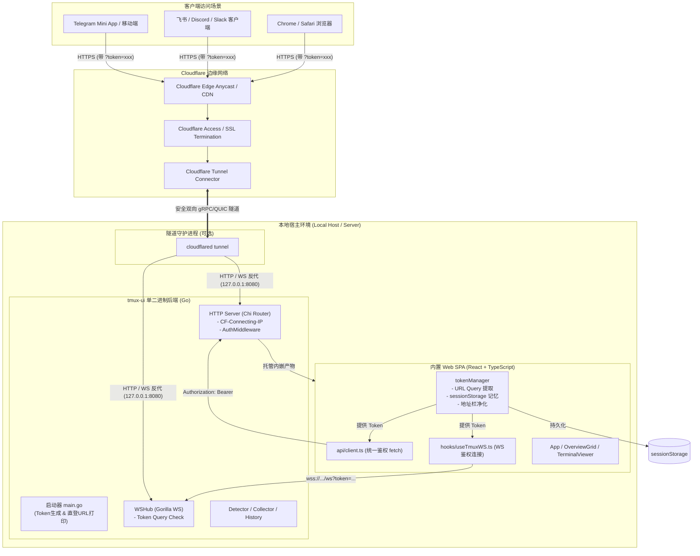
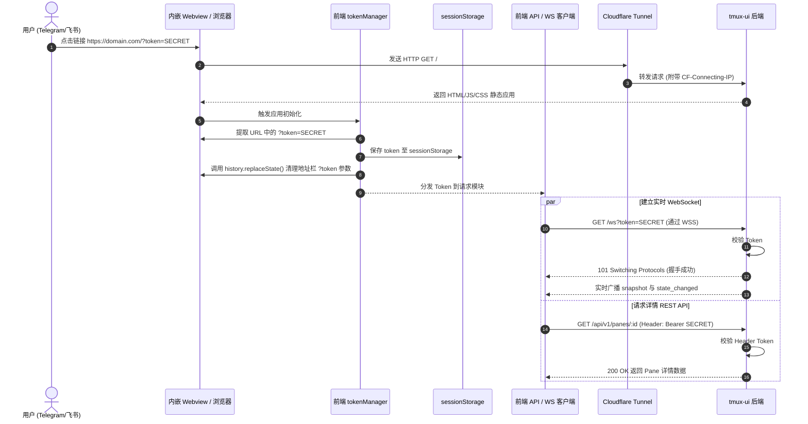

# 技术方案设计（Design）

> 文件路径：`docs/spec/versions/v3/design.md`
> 适用版本：v3 · 生成日期：2026-11-12
> 前置依据：`docs/spec/versions/v3/requirements.md`

---

## 1. 项目结构

```
tmux-ui/
├── cmd/
│   └── tmux-ui/
│       └── main.go                 # 服务端主入口（集成 Tunnel 模式检测、安全 Token 自动生成与公网直登 URL 打印）
├── config/
│   ├── agents.yaml                 # 规则配置
│   └── tunnel.yml.example          # [v3 新增] Cloudflare 命名隧道配置模板
├── internal/
│   ├── collector/                  # tmux CLI 调用与 ps 进程探测（沿用）
│   ├── detector/                   # 规则引擎推断（沿用）
│   ├── history/                    # 历史快照持久化引擎（沿用）
│   ├── store/                      # 内存状态存储（沿用）
│   ├── server/                     # HTTP REST 路由与 WebSocket Hub
│   │   ├── http_server.go          # [v3 扩展] 增强 RealIP 中间件适配 CF-Connecting-IP 与反向代理
│   │   └── ws_hub.go               # WebSocket 鉴权与广播
│   ├── tunnel/                     # [v3 新增] Cloudflare Tunnel 桥接与直登链接生成器
│   │   ├── tunnel.go               # 快速临时隧道拉起、命名隧道检测、安全随机 Token 生成
│   │   └── tunnel_test.go          # 单元测试
│   └── model/                      # 领域实体
├── web/                            # 前端工程
│   ├── src/
│   │   ├── auth/                   # [v3 新增] 认证凭证统一管理模块
│   │   │   ├── tokenManager.ts     # URL Query Token 提取、sessionStorage 记忆与地址栏净化
│   │   │   └── tokenManager.test.ts # 单元测试
│   │   ├── api/                    # [v3 新增] 统一 HTTP API 客户端封装
│   │   │   ├── client.ts           # 自动注入 Authorization Bearer Token 的 fetchWithAuth 封装
│   │   │   └── client.test.ts      # 单元测试
│   │   ├── components/
│   │   │   ├── AuthErrorBanner.tsx # [v3 新增] 鉴权失败与 Token 无效提示组件
│   │   │   ├── OverviewGrid.tsx
│   │   │   ├── TerminalViewer.tsx
│   │   │   └── PlaybackBar.tsx     # [v3 改造] 接入 client.ts 统一鉴权请求
│   │   ├── hooks/
│   │   │   ├── useTmuxWS.ts        # [v3 改造] 自动联动 tokenManager 获取 Token 并注入 WebSocket URL
│   │   │   └── useHistory.ts       # [v3 改造] 接入 client.ts 统一鉴权请求
│   │   ├── App.tsx                 # [v3 改造] 初始化加载 Token、展示 AuthErrorBanner
│   │   └── types/
│   └── tailwind.config.js
└── docs/
    ├── cloudflare-tunnel.md        # [v3 新增] Cloudflare Tunnel 生产与快速穿透实战部署指南
    └── spec/
        └── versions/
            └── v3/
                ├── requirements.md
                ├── design.md
                ├── data.md
                ├── api.md
                ├── tasks.md
                └── traceability.md
```

---

## 2. 架构概览

### 2.1 系统架构图



### 2.2 核心数据流图（直登免密鉴权与数据交互）



---

## 3. 技术选型

| 模块 / 需求 | 选型 | 选型理由 |
|------------|------|---------|
| 公网隧道代理 | Cloudflare Tunnel (`cloudflared`) | 零端口映射要求，免公网固定 IP，自带免费全球 CDN 与 HTTPS 证书，原生支持全双工 WebSocket 长连接 |
| 前端 Token 持久化 | 浏览器 `sessionStorage` | 标签页/Webview 容器关闭后自动销毁，防止公用电脑残留长期密钥，相比纯内存可应对用户意外 F5 刷新 |
| URL 隐私净化 | `window.history.replaceState` | 无刷新平滑抹除地址栏中的 Token 参数，防截图分享时凭据外泄，提升内嵌应用审美与安全性 |
| 前端 HTTP 统一鉴权 | 原生 Fetch 封装 (`api/client.ts`) | 轻量无第三方庞大依赖（无需 Axios），集中注入 Bearer Token 和通用错误解析 |
| 后端安全 Token 随机生成 | Go `crypto/rand` | CSPRNG 密码学安全随机源，生成 32 字节 Hex 字符串（256 位熵），杜绝伪随机预测 |

---

## 4. 测试工具选型

- **Go 后端测试**：Go 标准库 `testing` + `net/http/httptest`
- **React 单元与组件测试**：`Vitest` + `React Testing Library`
- **桌面与移动端 E2E / 视觉回归**：`Playwright MCP`

---

## 5. 安全性设计

1. **公网暴露强制鉴权保障**：
   - 当启动公网 Tunnel 模式时，系统强制检验是否配置了 `token`。若未配置，后端通过 `crypto/rand` 自动生成 32 字节高强度随机 Token，并输出高亮警告，坚决杜绝服务在公网裸奔。
2. **反向代理真实源 IP 溯源**：
   - 提取 `CF-Connecting-IP` 校验真实来源，避免代理透传篡改。
3. **前端地址栏防泄露防窥视（Token Scrubbing）**：
   - 客户端在首次启动解析完 `token` 并成功写入 `sessionStorage` 后，立即通过 `window.history.replaceState({}, document.title, cleanPath)` 清除 URL 后的 Query 参数，确保用户在 Telegram 等界面截屏或复制当前网页链接时不会把密码附带泄露。
4. **统一 401 拦截与引导**：
   - 前端网络层捕获 401 时展示友好英文告警提示，不造成页面空白崩塌。

---

## 6. 数据与配置设计

详细数据结构与环境变量设计见独立文档：
→ 详见 `docs/spec/versions/v3/data.md`

---

## 7. 接口设计

详细 API 规范与反向代理协议头设计见独立文档：
→ 详见 `docs/spec/versions/v3/api.md`
